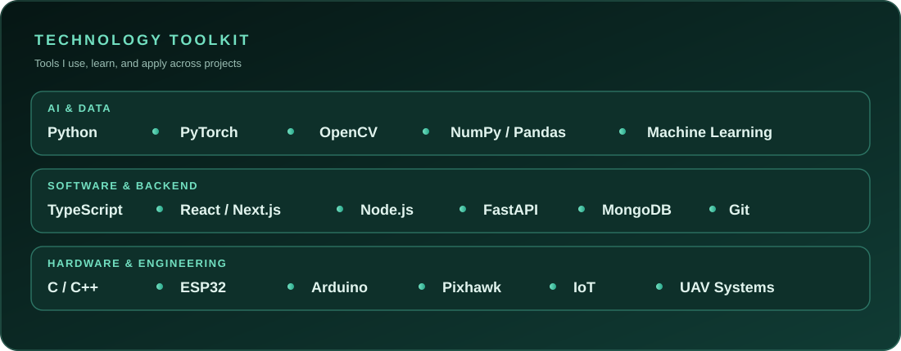

 

---

## About

I'm **Millu**, a Data Science student and hands-on technology enthusiast exploring the intersection of **Artificial Intelligence, Robotics, Embedded Systems, and Unmanned Aerial Vehicles (UAVs)**.

I’m interested in building systems where software meets the physical world — combining intelligent algorithms, sensors, microcontrollers, communication links, and reliable hardware. My learning style is practical: build small, test carefully, understand the constraints, and improve through iteration.

- **Core direction:** AI · Robotics · Embedded Systems · UAVs
- **Exploring:** Computer vision, machine learning, IoT, telemetry, and autonomous systems
- **Building mindset:** Practical experimentation, measurable improvements, and documented learning
- **Current curiosity:** Connecting software, sensors, and embedded devices into dependable intelligent systems

## Engineering domains

  

## Technology toolkit

  

### Development environment

  

<blockquote>
  
This toolkit reflects technologies I work with and explore. My experience varies by tool, and I’m continuously strengthening the fundamentals through practical work.

</blockquote>

## What I'm working toward

- Strengthening embedded C/C++ and microcontroller programming fundamentals
- Integrating sensors, telemetry, and edge intelligence into useful IoT systems
- Applying computer vision and machine learning to real-world engineering problems
- Learning UAV subsystem design, integration, and testing with safety and reliability in mind
- Sharing experiments, technical notes, and reproducible builds as I learn

## GitHub activity

  
  

  

---

**Build thoughtfully. Test honestly. Keep learning.**

<a href="https://github.com/its-millu">GitHub</a> · Open to learning, collaboration, and practical engineering projects.

Original profile copy and SVG artwork created for Millu's GitHub profile.

