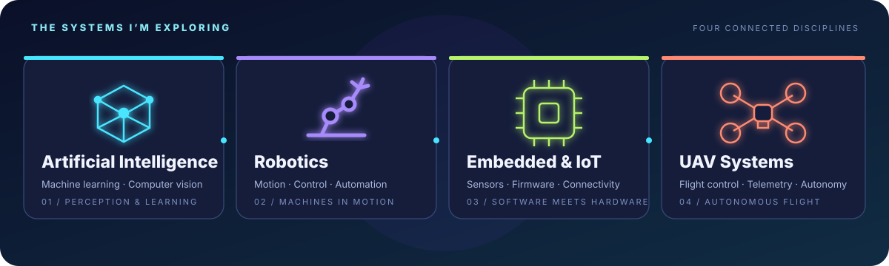

 

---

## ✦ About

I'm **Millu**, a Data Science student exploring the space where **Artificial Intelligence meets the physical world**.

My interests span intelligent software, robotics, embedded development, and unmanned aerial systems. I enjoy understanding how the whole stack fits together: data and algorithms, code and control, sensors and electronics, communication and real-world testing.

- **Core direction** — AI · Robotics · Embedded Systems · UAVs
- **Exploring** — Computer vision, machine learning, IoT, telemetry, and autonomous systems
- **Build philosophy** — Prototype with purpose, test against real constraints, learn from failure, iterate
- **Long-term goal** — Create dependable intelligent systems that sense, decide, and act

## ✦ Engineering playground

  

## ✦ Technology constellation

  

### Development environment

  

<blockquote>
  This is a working toolkit, not a claim of equal expertise across every technology. I keep strengthening the fundamentals through hands-on projects and experiments.
</blockquote>

## ✦ Current trajectory

- Deepening embedded C/C++ and microcontroller programming fundamentals
- Connecting sensors, telemetry, and edge intelligence into useful IoT systems
- Applying computer vision and machine learning to practical engineering problems
- Learning UAV subsystem integration, testing, and safety-minded development
- Documenting experiments and sharing reproducible technical work

## ✦ GitHub signal

  
  

  

---

### Build boldly. Test carefully. Keep exploring.

<a href="https://github.com/its-millu">GitHub</a> · Open to learning, collaboration, and practical engineering projects.

Original profile copy and custom SVG artwork · Aurora Circuit visual identity

